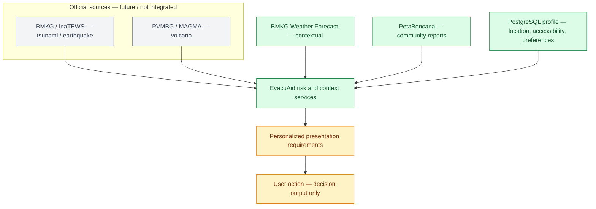

# EvacuAid Backend

EvacuAid is a Docker-first FastAPI backend for personalized disaster context. It combines contextual BMKG weather, PetaBencana community reports, a user's saved location, accessibility needs, and delivery preferences into transparent guidance for the frontend.

It is **not** a hazard-prediction system and does not generate official warnings. Community reports can produce `WATCH`, `ELEVATED`, or `PREPARE`; they never independently produce `EVACUATE`. `official_status` remains `null` until a verified authoritative warning source is integrated.

## Architecture and current stage

Green nodes are implemented, amber nodes are partial, and grey nodes are future work. The official-source branch is deliberately separate from contextual data and must not be presented as live until its API is verified and integrated.



| Diagram stage | Status sekarang | Letak file / bukti implementasi |
| --- | --- | --- |
| Official sources: BMKG / InaTEWS and PVMBG / MAGMA | Belum diintegrasikan. `official_status` tidak dibuat dari forecast atau citizen report. | `app/services/risk_service.py`, `app/models/risk.py` |
| Contextual source: BMKG Weather Forecast | Selesai: fetch, normalize, raw/processed JSON, fallback error. | `app/services/bmkg_service.py`, `app/config.py` |
| Contextual source: PetaBencana reports | Selesai: fetch GeoJSON, normalize, distance filtering, fallback error. | `app/services/petabencana_service.py`, `app/services/risk_service.py` |
| User profile store | Selesai: persisted user, location, multi-value accessibility, and delivery preferences. | `app/db/models/`, `app/repositories/users.py`, `app/routers/users.py`, `alembic/versions/20260920_01_profile_foundation.py` |
| EvacuAid risk and context services | Selesai: aggregate source + saved user context, calculate exposure/signal/action/confidence, and return explainable requirements. | `app/services/risk_service.py`, `app/routers/context.py`, `app/models/context.py` |
| Personalization | Parsial but usable: voice, vibration, text, accessible-route, and assistance requirements are returned. They do not change hazard severity. | `app/models/risk.py`, `app/services/risk_service.py` |
| User action | Decision output only: `MONITOR`, `PREPARE`, or a future official instruction. No push notification, buddy request, rescue dispatch, or route guidance yet. | `app/models/risk.py`, `app/services/risk_service.py` |
| Live frontend integration | Belum termasuk Compose stack; frontend must call the API and render the response. | `../frontend/`, `POST /api/risk`, `GET /v1/context` |

**MVP boundary:** EvacuAid remains flood-first. Do not add tsunami/earthquake or volcano features only because they appear in the future architecture branch.

## Runtime architecture

```text
Frontend
  ├─ POST /api/risk               stateless contextual assessment
  └─ GET /v1/context?user_id=...  persisted-user contextual assessment
                 │
                 ▼
            FastAPI backend
              ├─ PostgreSQL 16 + PostGIS 3.4: user profile data
              ├─ Redis 7: best-effort source-response cache for /v1/context
              ├─ BMKG weather forecast
              └─ PetaBencana community reports
```

PostgreSQL is the canonical profile store. The migration enables PostGIS for future spatial work, but the current user model stores decimal latitude/longitude and uses Haversine distance in the application; no PostGIS geometry query is implemented yet.

Redis is non-authoritative. It caches BMKG weather for 5 minutes and PetaBencana reports for 60 seconds only when `/v1/context` is called. If Redis fails, the request fetches usable live data instead. The legacy `/api/weather`, `/api/reports`, and `/api/risk` endpoints do not use Redis.

## Start with Docker

Prerequisite: Docker Desktop with Docker Compose enabled. Stop a local Uvicorn server first if it already uses port `8000`.

From the repository root:

```powershell
Copy-Item backend\.env.example backend\.env
docker compose up --build
```

The backend applies Alembic migrations before starting Uvicorn. The API is available at <http://127.0.0.1:8000>; Swagger is at <http://127.0.0.1:8000/docs>.

Compose services:

- `backend`: FastAPI application and Alembic migration runner.
- `postgres`: PostgreSQL 16 with PostGIS 3.4; persisted in the `postgres_data` Docker volume.
- `redis`: transient cache; persisted in the `redis_data` Docker volume.

The Compose defaults (`evacuaid` / `change-me`) are development-only. Set `POSTGRES_DB`, `POSTGRES_USER`, and `POSTGRES_PASSWORD` through the root environment or Compose invocation for another environment. `backend/.env` contains application defaults for standalone backend execution.

## API

### Stateless MVP endpoints

- `GET /`
- `GET /health`
- `GET /api/weather?adm4=31.71.03.1001`
- `GET /api/reports?latitude=...&longitude=...&radius_m=...`
- `POST /api/risk`

`POST /api/risk` accepts coordinates plus optional accessibility/delivery flags and writes its latest complete response to `data/final_output.json`.

### Persisted user and context endpoints

- `POST /v1/users`
- `GET /v1/users/{userId}`
- `PATCH /v1/users/{userId}`
- `PUT /v1/users/{userId}/location`
- `GET|PUT /v1/users/{userId}/accessibility`
- `GET|PUT /v1/users/{userId}/preferences`
- `GET /v1/context?user_id={uuid}`

`GET /v1/context` requires a saved user location. It loads the profile, accessibility values, and delivery preferences, uses cached source responses when available, then returns risk context with stable `reason_codes` and presentation requirements.

## Data and migrations

`alembic/versions/20260920_01_profile_foundation.py` creates:

- `users`: UUID profile, optional coordinates, assistance flag, timestamps.
- `user_accessibility`: normalized multi-value accessibility attributes per user.
- `user_preferences`: voice, vibration, text, and language preferences.

Runtime source snapshots are created under `data/raw/` and `data/processed/`; the latest stateless risk response is `data/final_output.json`. Docker mounts `backend/data` so these outputs survive container replacement.

## Tests

With the stack running:

```powershell
docker compose exec backend pytest -q
docker compose exec backend alembic current
```

The suite covers profile persistence, accessibility and preference updates, context orchestration, Redis fallback, coordinate validation, explainable reason codes, and the invariant that citizen reports cannot independently trigger evacuation.

## Safety and future work

- Do not infer `SIAGA`, `AWAS`, or evacuation from weather values, report distance, or citizen reports.
- Do not claim current reports mean there is no disaster outside the query result.
- Future work: verified official-warning ingestion, buddy relationships, assistance workflow, shelter/route data, and notification delivery.
