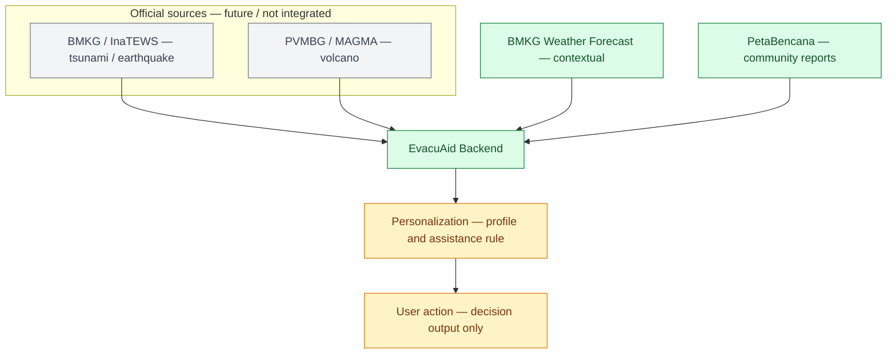

# EvacuAid Backend

EvacuAid is a Docker-first FastAPI backend for personalized disaster context. PostgreSQL with PostGIS is the canonical profile store. Redis is a best-effort cache for BMKG and PetaBencana source responses.

<<<<<<< Updated upstream
## Architecture
=======
It is **not** a hazard-prediction system and does not create official warnings. `official_status` stays `null` because this MVP does not integrate an authoritative warning/instruction feed. BMKG forecasts are contextual weather data; PetaBencana `/reports` data is community reporting. A nearby report can result in `ELEVATED` and `PREPARE`, never `EVACUATE`.

## Architecture and current stage

The diagram shows the intended EvacuAid flow. Green nodes are implemented for this MVP, amber nodes are partially implemented, and grey nodes are future work. The official-source branch is deliberately separate from contextual data: it must not be represented as live until a verified authoritative API is integrated.



| Diagram stage | Status sekarang | Letak file / bukti implementasi |
| --- | --- | --- |
| Official source: BMKG / InaTEWS (tsunami / earthquake) | Belum diintegrasikan. | Belum ada service; `official_status` sengaja selalu `null` di `app/services/risk_service.py`. |
| Official source: PVMBG / MAGMA (volcano) | Belum diintegrasikan. | Belum ada service atau endpoint. |
| Contextual source: BMKG Weather Forecast | Selesai untuk MVP: fetch, normalize, raw/processed JSON, fallback error. | `app/services/bmkg_service.py`, `app/config.py`, `data/raw/bmkg_raw.json`, `data/processed/bmkg_normalized.json` |
| Contextual source: PetaBencana reports | Selesai untuk MVP: fetch GeoJSON, normalize, distance filtering, fallback error. Ini adalah community reports, bukan official warning. | `app/services/petabencana_service.py`, `app/services/risk_service.py`, `data/raw/petabencana_raw.json`, `data/processed/petabencana_normalized.json` |
| EvacuAid Backend aggregation | Selesai untuk MVP: gabungkan source + user coordinates, hitung exposure, signal, action, confidence, lalu simpan output. | `app/services/risk_service.py`, `app/utils/geo.py`, `app/main.py`, `data/final_output.json` |
| Personalization | Parsial: menerima `user_profile` dan `needs_assistance`; hanya `MOBILITY_LIMITATION` atau explicit request yang mengaktifkan physical-assistance flag. | `app/models/risk.py`, `app/services/risk_service.py` |
| User action | Parsial: mengembalikan `MONITOR` atau `PREPARE`; belum mengirim push alert, meminta buddy, atau mengarahkan rute. | `app/models/risk.py`, `app/services/risk_service.py` |
| Live frontend integration | Belum: frontend masih memakai simulated location/buddy source dan belum memanggil `/api/risk`. | `../frontend/src/features/buddy-map/location-source.ts`, future client for `POST /api/risk` |

**MVP boundary:** the adopted scope is flood-first. Do not add the tsunami/earthquake or volcano branch merely because it appears in the future architecture diagram; first decide to expand scope and verify the relevant official APIs.

## Folder structure
>>>>>>> Stashed changes

```text
Frontend -> FastAPI -> PostgreSQL + PostGIS
                    -> Redis cache
                    -> BMKG and PetaBencana
```

Community reports are supporting evidence only: without an authoritative warning, they can produce `WATCH`, `ELEVATED`, or `PREPARE`, never `EVACUATE`.

## Start

From `backend`:

```powershell
Copy-Item .env.example .env
```

From the repository root:

```powershell
docker compose up --build
```

The API is available at `http://127.0.0.1:8000`; Swagger is at `/docs`.

## Docker services

- `backend`: FastAPI, migrations applied before Uvicorn starts
- `postgres`: PostgreSQL 16 with PostGIS 3.4
- `redis`: transient cache only

Compose defaults are development-only. Configure `POSTGRES_DB`, `POSTGRES_USER`, and `POSTGRES_PASSWORD` in the root environment or Compose invocation; configure `DATABASE_URL` and `REDIS_URL` in `backend/.env` for non-Compose deployment.

## Migrations and tests

```powershell
docker compose exec backend alembic upgrade head
docker compose exec backend pytest
```

The test suite covers profile persistence, coordinate validation, multiple accessibility attributes, preferences, context orchestration, Redis fallback, explainable decision reasons, and the invariant that citizen reports cannot independently trigger evacuation.

## API

Existing MVP endpoints remain available:

- `GET /`
- `GET /health`
- `GET /api/weather`
- `GET /api/reports`
- `POST /api/risk`

Profile endpoints:

- `POST /v1/users`
- `GET /v1/users/{userId}`
- `PATCH /v1/users/{userId}`
- `PUT /v1/users/{userId}/location`
- `GET|PUT /v1/users/{userId}/accessibility`
- `GET|PUT /v1/users/{userId}/preferences`
- `GET /v1/context?user_id={uuid}`

`/v1/context` loads the persisted user, location, accessibility, and preferences, then delegates exposure and recommendation generation to the risk service. Its action includes stable `reason_codes` and presentation requirements. Accessibility changes delivery requirements, not hazard severity.

## Schema and current scope

The initial Alembic revision creates:

- `users`: UUID profile, optional coordinates, assistance flag, timestamps
- `user_accessibility`: normalized multi-value attributes with one type per user
- `user_preferences`: one-to-one voice, vibration, text, and language preferences

Implemented: profile persistence, profile APIs, v2 explainable risk fields, source caching with graceful Redis failure, and unified context.

Partial: authoritative warning ingestion is future-ready only; no official source is fabricated.

Future: buddy relationships, assistance workflow, shelter routing, and notification delivery. Context truthfully returns `NOT_REQUESTED` assistance and `NOT_REQUIRED` navigation until those systems exist.
